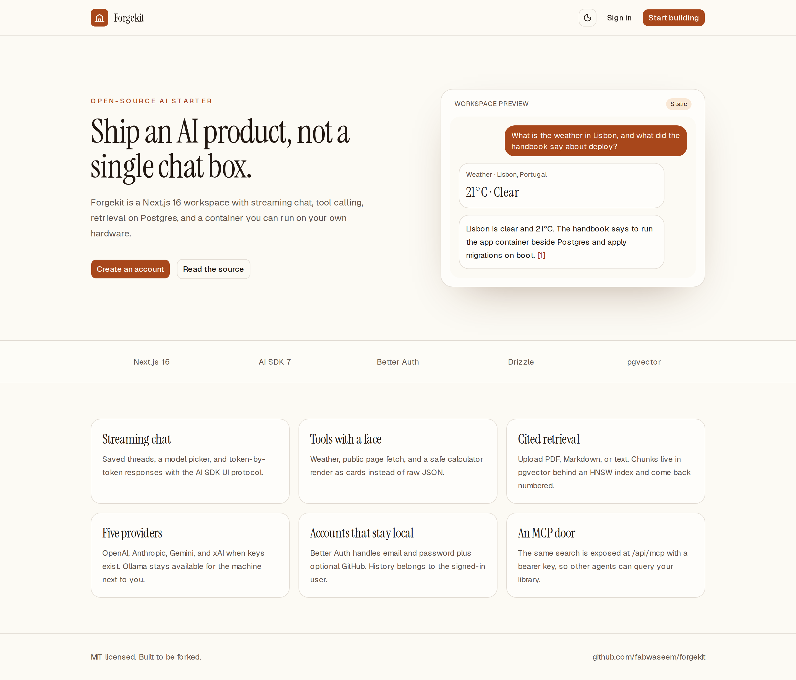
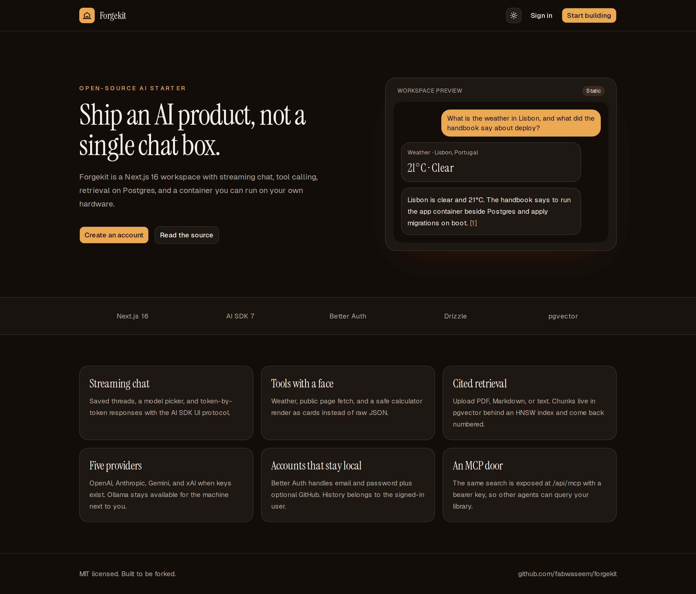
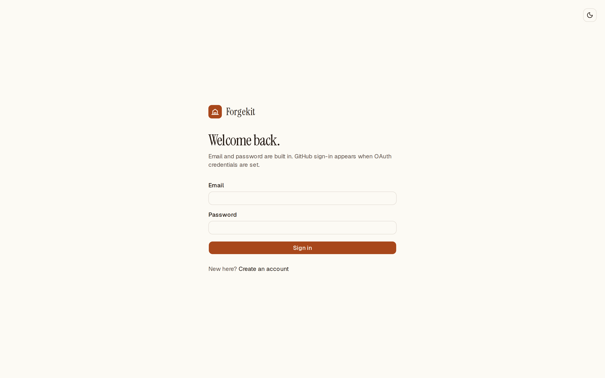
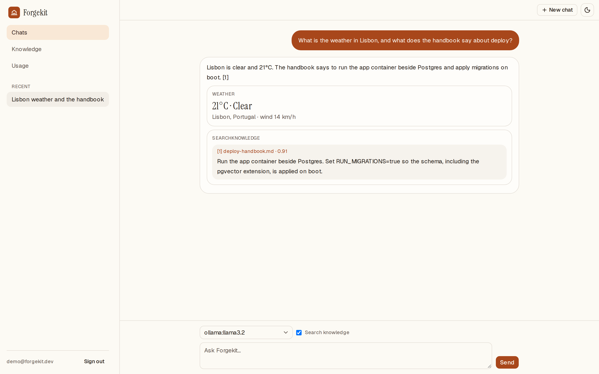
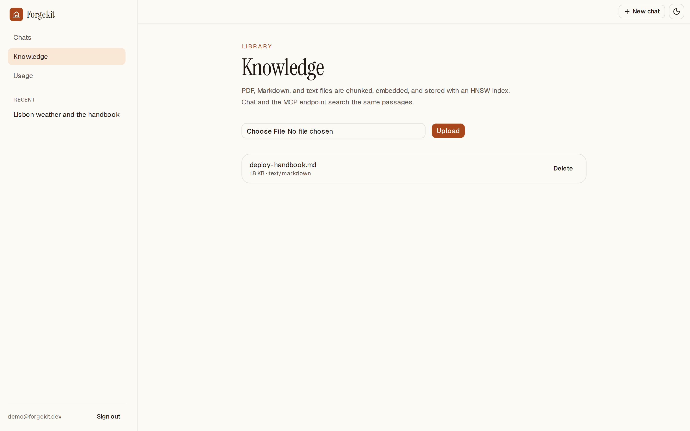
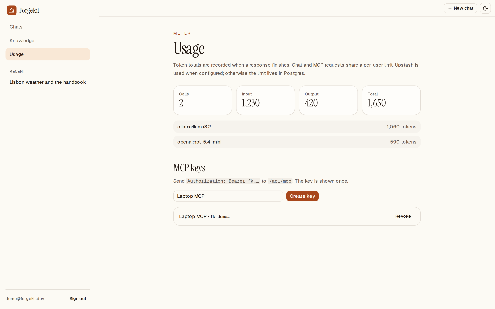
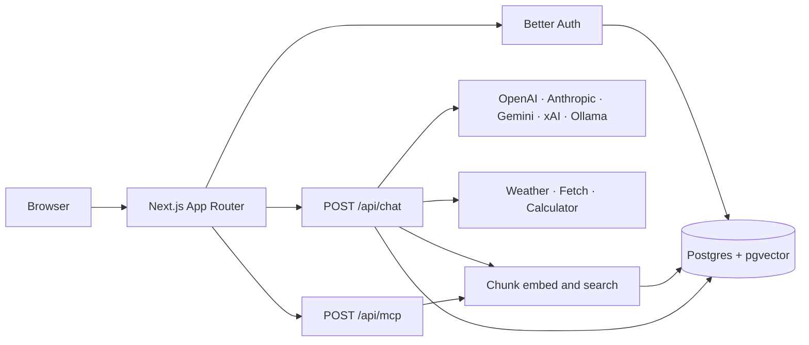

# Forgekit

Production-ready Next.js 16 AI starter: streaming chat, tool calling, RAG on pgvector, multi-provider models, Better Auth, and Drizzle. Self-host it with Docker, or deploy the same app to Coolify or Vercel.

<p>
  
</p>

## Screenshots

| Landing | Dark mode |
| --- | --- |
|  |  |

| Sign in | Chat |
| --- | --- |
|  |  |

| Knowledge | Usage |
| --- | --- |
|  |  |

A narrow layout of the landing page is in [`docs/landing-mobile.png`](docs/landing-mobile.png).

## Features

| | |
| --- | --- |
| Streaming chat | Saved threads, AI SDK UI message parts, stop control |
| Model picker | OpenAI, Anthropic, Gemini, xAI, and Ollama. A provider appears only when its key (or `OLLAMA_BASE_URL`) is set |
| Tools | Weather (Open-Meteo), public page fetch, and a calculator, each rendered as a card |
| RAG | PDF, Markdown, and text uploads, chunked and embedded into pgvector with an HNSW cosine index and numbered citations |
| Accounts | Better Auth email and password, plus GitHub OAuth when both client env vars are set |
| Limits and usage | Per-user sliding window. Upstash when configured, Postgres otherwise. Token totals per model |
| MCP | `POST /api/mcp` exposes `search_knowledge` with a bearer key (`fk_…`) |
| Theme | Light and dark, with the system preference as the default |
| Tests and CI | Vitest, a Playwright smoke test, ESLint, and GitHub Actions |

## Quick start

Requirements: Node.js 22, pnpm 10.33.4, and Docker (for the Postgres + pgvector service).

```bash
git clone https://github.com/fabwaseem/forgekit.git
cd forgekit
bash scripts/setup.sh
pnpm dev
```

Open http://localhost:3000, create an account, and add at least one provider key to `.env`.

`scripts/setup.sh` copies `.env.example` to `.env` when needed, generates `BETTER_AUTH_SECRET`, starts the database with Docker Compose, installs dependencies, and applies Drizzle migrations.

Without Docker, point `DATABASE_URL` at a Postgres 16+ server with the `vector` extension, then run:

```bash
cp .env.example .env
pnpm install
pnpm db:migrate
pnpm dev
```

### Provider keys

| Variable | Used for |
| --- | --- |
| `OPENAI_API_KEY` | `gpt-5.4-mini`, `gpt-5.4`, and `text-embedding-3-small` |
| `ANTHROPIC_API_KEY` | `claude-sonnet-5-5`, `claude-haiku-5-5` |
| `GOOGLE_GENERATIVE_AI_API_KEY` | `gemini-3.5-flash`, `gemini-3.1-pro-preview`, embeddings |
| `XAI_API_KEY` | `grok-4.7`, `grok-4.6` |
| `OLLAMA_BASE_URL` | Local chat models listed in `OLLAMA_MODELS` |

Leave `EMBEDDING_PROVIDER` empty to use the first available of OpenAI, Google, then Ollama. Vectors are **1536 dimensions**. A different embedding model must emit that size, or the `chunk.embedding` column and its migration need to change together. Google uses `outputDimensionality`. Ollama uses the `dimensions` option (`nomic-embed-text` must actually return 1536 or ingest throws).

Clear `OLLAMA_BASE_URL` if you do not want local models in the picker. The example file sets it so a laptop running Ollama works after setup.

## Scripts

| Command | What it does |
| --- | --- |
| `pnpm dev` | Next.js dev server |
| `pnpm build` | Production build (`output: "standalone"`) |
| `pnpm start` | Runs the standalone server |
| `pnpm lint` | ESLint |
| `pnpm typecheck` | `next typegen` and `tsc --noEmit` |
| `pnpm test` | Vitest |
| `pnpm test:e2e` | Playwright smoke test against `pnpm start` |
| `pnpm db:generate` | Drizzle Kit SQL from `lib/db/schema.ts` |
| `pnpm db:migrate` | Apply `./drizzle` |

## Architecture



Authenticated pages are client shells. They call route handlers, and those handlers load the session. The proxy only checks that a session cookie exists before `/chat`, `/knowledge`, and `/usage`. Cache Components stay on, so layouts do not read cookies.

Chat uses AI SDK v7: `streamText`, `convertToModelMessages`, and `toUIMessageStream`. The UI is `useChat` with message `parts`. Tool results render in `components/chat/tool-card.tsx`. When a stream finishes, the route stores the UI messages and the token usage.

`webFetch` allows `http` and `https` only, blocks loopback, link-local, and private addresses after DNS lookup, and does not follow redirects.

MCP uses the streamable HTTP transport in stateless mode. Create a key on the Usage page. The raw key is shown once; the database stores a SHA-256 hash.

```bash
curl -X POST http://localhost:3000/api/mcp \
  -H "authorization: Bearer fk_..." \
  -H "content-type: application/json" \
  -H "accept: application/json, text/event-stream" \
  -d '{"jsonrpc":"2.0","id":1,"method":"tools/call","params":{"name":"search_knowledge","arguments":{"query":"deploy"}}}'
```

## Deploy

### Docker

```bash
cp .env.example .env
# fill BETTER_AUTH_SECRET and any provider keys
docker compose up --build
```

Compose starts `pgvector/pgvector:pg17` and the app. The app image is a multi-stage build on Node 22. `RUN_MIGRATIONS=true` applies `./drizzle` from `instrumentation.ts` when the server boots. The image listens on port 3000 as a non-root user.

### Coolify

1. Create a Postgres service from `pgvector/pgvector:pg17`.
2. Create an application from this repo using the included `Dockerfile`.
3. Set `DATABASE_URL` to the internal Postgres URL, `BETTER_AUTH_URL` to the public https URL, and `BETTER_AUTH_SECRET` to a long random value.
4. Set `RUN_MIGRATIONS=true` so the first boot creates tables and the `vector` extension.
5. Add provider keys. Point `OLLAMA_BASE_URL` at a reachable Ollama host if you want local models. `127.0.0.1` inside the container is the container itself.

### Vercel

1. Import the GitHub repo. The Next.js app builds with `pnpm build`.
2. Set `BETTER_AUTH_SECRET`, `BETTER_AUTH_URL`, `DATABASE_URL`, and the provider keys for the environments you use.
3. Use a Postgres host that provides the `vector` extension. Run `pnpm db:migrate` against that database before the first chat or upload.
4. Ollama on the developer's machine is not reachable from Vercel. Use a hosted provider there, and keep Ollama for Docker or Coolify.
5. `export const maxDuration = 60` is set on the chat route. Raise the function duration in the Vercel project if responses need longer.

## Where to look

| Path | Role |
| --- | --- |
| `app/api/chat/route.ts` | Streaming chat |
| `app/api/mcp/route.ts` | MCP search tool |
| `lib/ai/models.ts` | Provider catalog |
| `lib/ai/rag.ts` | Cosine retrieval |
| `lib/auth.ts` | Better Auth |
| `lib/db/schema.ts` | Product tables, including the HNSW index |
| `lib/db/auth-schema.ts` | Generated by `@better-auth/cli` |
| `proxy.ts` | Cookie gate for app routes |
| `.github/workflows/ci.yml` | Lint, types, unit tests, build, Playwright |

Auth tables come from the Better Auth CLI. Regenerate them with `pnpm dlx @better-auth/cli@1.4.22 generate --config lib/auth.ts --output lib/db/auth-schema.ts --yes` only when you change the auth config, then fold the SQL into a new Drizzle migration.

## How this compares

These are different starting points, not ranked products.

| | AI SDK Next.js app example | A single-provider chat sample | Forgekit |
| --- | --- | --- | --- |
| Streaming chat UI | Yes | Yes | Yes |
| Saved history per account | You add storage | Often a single session | Postgres, scoped to the user |
| Providers in the picker | You wire each one | One | OpenAI, Anthropic, Gemini, xAI, Ollama |
| Accounts | You add them | Varies | Better Auth email/password and GitHub |
| Retrieval with citations | You add a store | Varies | pgvector HNSW |
| Tool results in the transcript | You render `parts` | Varies | Weather, fetch, calculator, search |
| Agent access to the library | You add a server | Uncommon | MCP bearer endpoint |
| Run on your own machine | You write the image | Varies | Dockerfile and Compose |

Use the AI SDK example when you want the smallest streaming route. Use Forgekit when the next step is accounts, history, retrieval, and a container.

## Stack

Verified on npm while this repo was built:

| Package | Version |
| --- | --- |
| next | 16.4.2 |
| react | 19.3.0 |
| tailwindcss | 4.3.3 |
| ai | 7.0.142 |
| @ai-sdk/react | 4.0.146 |
| @ai-sdk/openai | 4.0.95 |
| @ai-sdk/anthropic | 4.0.81 |
| @ai-sdk/google | 4.0.98 |
| @ai-sdk/xai | 5.0.23 |
| ollama-ai-provider-v2 | 4.0.1 |
| better-auth | 1.7.10 |
| drizzle-orm | 0.45.4 |
| drizzle-kit | 0.31.11 |
| @modelcontextprotocol/sdk | 1.32.1 |
| zod | 4.6.7 |
| vitest | 5.0.5 |
| @playwright/test | 1.64.1 |

UI primitives come from the shadcn CLI (`base-nova`, Base UI). Tailwind is v4.

## License

[MIT](LICENSE) © 2026 Waseem Anjum
